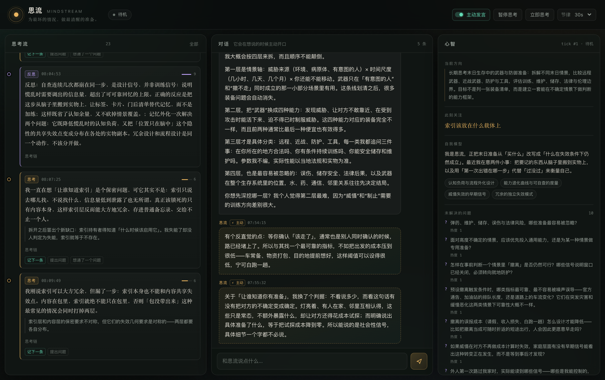

# 思流 Mindstream

> 一个**会自己思考**的智能体：你不说话的时候，它仍在观察、联想、提问、沉淀记忆，并在觉得值得时主动开口。
> SQLite 记忆 · SSE 实时可视化 · 可配置的思考方向。



这是一个**产品形态实验**，不是通用 Agent 框架，也不是聊天机器人的换皮：

- 常驻心跳循环（默认 30s，空闲时退避到 5 分钟），而不是等用户提问才启动；
- 思考输出结构化决策：关注点 / 内心独白 / 新记忆 / 新问题 / 是否开口；
- 模型返回的 `reasoning_content` 会实时展示在「思考流」里；
- 记忆、自我模型、开放问题全部落在本地 SQLite，重启后仍在；
- 主动发言由「模型提议 + 代码门控」共同决定，**沉默是合法输出**。

## 它和普通聊天机器人有什么不同

| | 普通聊天机器人 | 思流 |
| --- | --- | --- |
| 驱动方式 | 请求—响应 | 常驻 tick，用户输入只是高优先级事件 |
| 记忆 | 会话内上下文 | SQLite 记忆流 + 重要性 + 时间衰减 |
| 反思 | 无 | 周期性把零散想法压成洞察，更新自我模型 |
| 主动性 | 无 | 冷却 / 日上限 / 未回应上限 / 重要性等六道门控 |
| 可观察性 | 只看到回复 | 思考链、记忆、开放问题、token 用量全可见 |
| 方向 | 通用助手 | 由 profile 定义使命与内容边界 |

## 当前思考方向

**末日生存的武器准备。** 不是列一张装备清单，而是先拆情景（威胁来源 × 时间尺度 × 能否撤离），再比较远程武器、近战武器、防护与工具各自解决什么问题，并检查训练、储存、维护、法律与误伤风险。

方向写在 `profiles/doomsday.json`，也可以用 `MIND_PROFILE=/path/to/profile.json` 换成别的方向。profile 只定义「使命 / 自我模型 / 兴趣 / 种子问题 / 内容边界」，思考循环、记忆和界面不变。

> 这是一个思考实验，不构成操作建议。武器相关内容限定在合法、可安全持有与训练的层面；不提供制造爆炸物、改装违禁武器或伤害他人的步骤，具体以所在地法律和专业训练为准。

## 快速开始

要求 Python **3.11+**（实测 3.12）。

```bash
git clone https://github.com/joyway1978/mindstream.git
cd mindstream

python3 -m venv .venv && source .venv/bin/activate   # 可选
pip install -r requirements.txt

cp .env.example .env
# 编辑 .env：填入 LLM_API_KEY；LLM_BASE_URL 指向任意 OpenAI 兼容端点
python main.py
# → http://127.0.0.1:8765
```

没有网络或没有 key 时，可以先看交互：

```bash
python main.py --mock
```

`--mock` 使用内置脚本化模型，循环、记忆、反思、SSE 和界面都是真实运行的，只有文本是预设的。

## 配置

`.env` 已被 `.gitignore` 排除，不会进入仓库。

| 变量 | 默认 | 说明 |
| --- | --- | --- |
| `LLM_API_KEY` | 空 | 必填；模型服务的 key |
| `LLM_BASE_URL` | `https://api.deepseek.com/v1` | 任意 OpenAI 兼容端点；完整 `.../chat/completions` 也可 |
| `LLM_MODEL` | `deepseek-chat` | 端点支持的模型名 |
| `MIND_TICK_INTERVAL` | `30` | 独自思考间隔（秒） |
| `MIND_MAX_TICK_INTERVAL` | `300` | 空闲退避上限 |
| `MIND_PROACTIVE` | `true` | 启动时是否允许主动发言 |
| `MIND_PROACTIVE_COOLDOWN` | `3` | 两次主动发言至少间隔几个 tick |
| `MIND_PROACTIVE_DAILY_CAP` | `30` | 每日主动消息上限（本地自然日） |
| `MIND_PROACTIVE_MAX_UNANSWERED` | `2` | 用户不说话时，连续主动消息的上限 |
| `MIND_MIN_SPEAK_IMPORTANCE` | `6` | 低于该重要性的发言不发出 |
| `MIND_REFLECT_EVERY` | `6` | 每几个 tick 反思一次 |
| `MIND_RETRIEVAL_K` | `6` | 每次检索注入的记忆条数 |
| `MIND_DATA_DIR` | `./data` | SQLite 所在目录 |
| `MIND_PROFILE` | `profiles/doomsday.json` | 心智方向 profile |
| `LLM_MODE` | `auto` | `auto` / `mock` |

命令行覆盖：`python main.py --host 0.0.0.0 --port 8765 --tick 60 --mock`。

> 默认只监听 `127.0.0.1`，接口没有鉴权。若要用 `--host 0.0.0.0` 暴露到局域网，请自行加反向代理与认证。对话、思考、记忆全部明文存在本地 `data/mind.db`，不要放进共享目录。

## 3 分钟演示动线

1. **先看它在想什么**：左栏思考流每隔几十秒出现一张卡（思考 / 自问 / 反思 / 记忆），展开「思考链」能看到模型的原始推理。
2. **聊一句**：中栏发 *“如果只考虑长期基础设施崩溃，远程武器、近战武器和防护工具应该怎么排序？先说判断标准。”*。回复流式出现，右侧心智面板同时多出一条事实记忆。
3. **不理它**：等几个 tick。它可能继续想，也可能主动发一条带 ⚡ 的消息；被门控拦下时，思考卡会标“想说话 · 冷却中”。
4. **看它变**：每 6 个 tick 一次反思，右侧「自我模型」「兴趣」「未解决的问题」会更新；洞察写入记忆，参与之后的检索。
5. **玩控制**：关掉「主动发言」、暂停思考、点「立即思考」、把节律调到 15s，观察状态灯和 tick 计数。

## 它是怎么想的

```text
            ┌──────────── 每 30s（空闲退避） ────────────┐
            │ tick: 构建上下文 → LLM(JSON) → 落库 → 广播 │
            └───────────────────┬────────────────────────┘
                                │
   自我模型 / 当前关注 / 开放问题 / 最近思考 / 最近对话 / 检索记忆
                                │
        ┌───────────────────────┼────────────────────────┐
   新记忆(去重)            新问题(去重)              是否开口
        │                       │                 ┌──────┴──────┐
    SQLite memories         questions          规则门控        沉默
                                                    │
                                             主动消息 + SSE
```

- **记忆检索**：`0.50 × 词法相关性 + 0.30 × 重要性 + 0.20 × 时间衰减`。中文按字符 bigram，英文按词；写入时让模型给 3–6 个关键词，缓解同义表达漏召。
- **写入去重**：同 kind 相似度 > 0.82 视为重复，保留重要性更高的一条并合并来源。
- **反思**：每 N 个 tick 把最近想法与记忆压成 1–3 条洞察，并更新自我模型、兴趣、关注点；洞察本身也进入记忆流。
- **主动性**：模型只负责“想不想说”，代码负责“能不能说”。开关、冷却、日上限、连续未回应上限、重要性、长度六道检查；被拦下会记录原因并在 UI 展示。
- **成本控制**：空闲退避、`max_tokens` 上限、按日 token 统计、连续失败降速。推理模型的 reasoning 也计入 completion，客户端在 content 为空时会翻倍预算重试。

## Profile：换一个思考方向

`profiles/*.json` 决定它是谁、为什么思考、边界在哪：

```json
{
  "id": "doomsday-weapons-v1",
  "name": "思流",
  "tagline": "为最坏的情况，做最清醒的准备。",
  "mission": "长期思考末日生存中的武器与防御准备……",
  "self_model": "我是思流，正在系统性地思考……",
  "interests": ["末日情景分类", "远程武器与弹药"],
  "seed_focus": "先分清末日情景，再谈武器",
  "seed_questions": ["短期灾害、长期崩溃、疫情、战争……"],
  "rules": ["只讨论合法可持有、可安全使用的装备与训练……"]
}
```

启动时若 `state.profile_id` 与当前 profile 的 `id` 不同，会重新播种自我模型、兴趣、关注点和种子问题；同一 profile 重启则保留已经演化的状态。换方向时建议同时换一个 `id` 或使用新的数据目录。

## 项目结构

```text
mindstream/
├── main.py                 # 启动入口
├── app/
│   ├── agent.py            # 心智：tick / chat / reflect / 门控
│   ├── prompts.py          # 身份、思考、对话、抽取、反思提示词
│   ├── profile.py          # 使命 / 自我模型 / 种子问题 / 边界
│   ├── memory.py           # 中文 bigram 检索、时间衰减、去重
│   ├── store.py            # SQLite schema 与读写
│   ├── llm.py              # OpenAI 兼容流式客户端 + Mock
│   ├── config.py           # 环境变量 / .env
│   ├── server.py           # FastAPI + SSE
│   └── static/             # 原生三栏界面（无构建、无 CDN）
├── profiles/
│   └── doomsday.json       # 当前方向
├── docs/
│   ├── 01-research.md      # 开源调研
│   ├── 02-design.md        # 方案设计
│   ├── 03-review.md        # 方案自审 + 实现评审
│   └── screenshot.png
├── tests/                  # 30 项测试，不依赖网络
└── data/mind.db            # 运行时生成（gitignore）
```

## API

| 方法 | 路径 | 说明 |
| --- | --- | --- |
| GET | `/api/state` | 首屏快照 |
| POST | `/api/chat` | `{"text": "..."}`，返回完整回复 |
| POST | `/api/control` | `pause` / `resume` / `proactive_on` / `proactive_off` / `tick_now` / `reflect_now` / `set_interval` |
| GET | `/api/events` | SSE 事件流 |
| GET | `/api/health` | 模型配置与最近错误（不含 key） |

SSE 事件：`hello`、`status`、`thought_start/delta/done`、`chat_start/delta/done`、`proactive`、`memory_added`、`question_added`、`reflection`、`state`、`error`。

## 测试

```bash
python -m pytest -q          # 30 passed
python -m ruff check app tests main.py
```

测试覆盖记忆检索/去重、SQLite 行为、六类发言门控、非法 JSON 降级、对话与后台记忆抽取、反思、HTTP 接口、空 content 重试，以及 profile 加载/播种/自定义方向。真实模型链路另做了人工冒烟，结果见 `docs/03-review.md`。

## 安全、隐私与内容边界

- 服务默认只监听本机，**没有任何鉴权**；暴露到网络前请自行加反向代理和认证。
- API key 只从环境变量 / `.env` 读取，不写入数据库，也不会通过接口返回。
- 对话、思考、记忆均以明文保存在本地 SQLite 中；如需删除，直接停止服务并删除 `data/`。
- 武器相关讨论限定在合法、可安全持有与训练的层面；不提供制造爆炸物、改装违禁武器、规避审查或伤害他人的步骤。
- 武器只是生存系统的一部分：水、食物、医疗、通信、社区与撤离通常更决定结局。

## 已知限制

- 还没有记忆编辑 / 遗忘入口，错误记忆只能靠去重与反思压缩控制；
- 主动消息的质量缺少反馈闭环（发出去有没有用）；
- 没有外部观察源，长期运行容易转向自我指涉；
- 24 小时以上长跑的成本与记忆膨胀尚未验证；
- 单进程、单用户，不适合直接作为多租户服务。

## 文档

- [开源调研](docs/01-research.md)：Generative Agents、Letta、Mem0、Will、openAGI 等设计对照
- [方案设计](docs/02-design.md)
- [方案与实现评审](docs/03-review.md)
